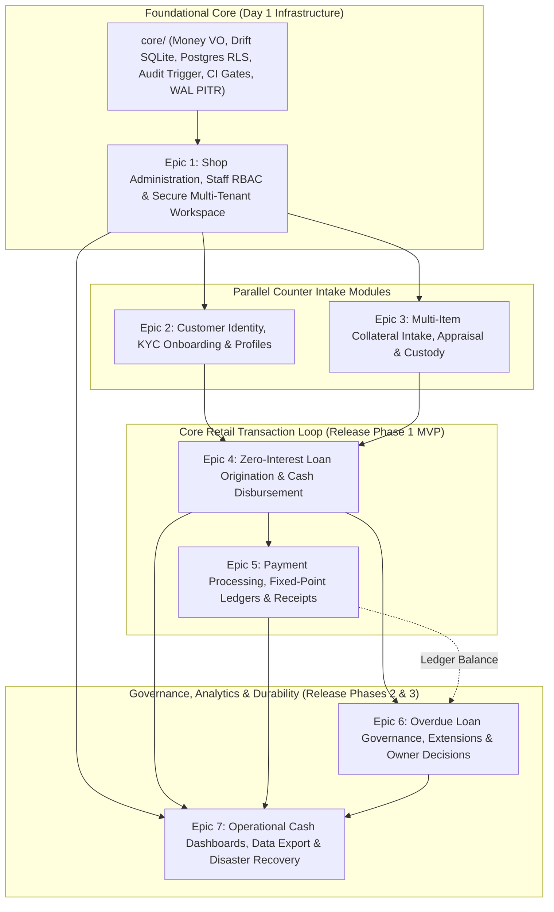

# credit_system - Epic Breakdown

## Overview

This document provides the complete epic and story breakdown for **Credit Management System**, decomposing all 33 requirements from the finalized Product Requirements Document (PRD) and 8 approved Architecture Decisions (AD-1 through AD-8) into user-value-focused, implementable epics and stories.

---

## Requirements Inventory

### Functional Requirements

* **FR-1:** Shop Profile Configuration (Shop name, business address, contact details, registration/tax numbers, shop logo, custom receipt header and footer notes; profile updates apply to future receipts without altering historical snapshots; tenant-isolated).
* **FR-2:** Shop Timezone & Calendar Semantics (Configurable shop local time zone defaulting to `Asia/Colombo`; automated overdue evaluation takes effect at 00:00:00 on the calendar day after due date).
* **FR-3:** Configurable Currency Display (Presentation formatting decoupled from base ledger currency; default Sri Lankan Rupees `LKR`; base ledger currency locked post-transaction to prevent misrepresenting financial records).
* **FR-4:** Strict Server-Side Tenant Isolation (RLS enforced across all queries, lookups, API routes, and database operations; zero cross-tenant leakage).
* **FR-5:** Staff Account Administration & Immediate Session Revocation (Owner creates, activates, deactivates staff accounts; deactivation immediately increments `session_version` and revokes active terminal sessions).
* **FR-6:** Granular 14-Permission RBAC Catalog (Explicit unmodifiable catalog: `registerCustomers`, `viewCustomers`, `viewSensitiveCustomerData`, `createLoans`, `confirmLoanDisbursement`, `recordPayments`, `viewAndReprintReceipts`, `viewOverdueLoans`, `recordCustomerNotes`, `requestCorrections`, `approveCorrections`, `confirmCollateralReturn`, `viewFinancialReports`, `viewAuditLogs`).
* **FR-7:** Restricted Platform Administrator Governance (Default-denied access to tenant customer PII and ledgers; emergency access requires explicit audited authorization).
* **FR-8:** Reusable Customer Profile Onboarding (Mandatory KYC fields: Full Name, NIC Number, Contact Phone, Address, Customer Photo; reusable across multiple loans in current shop).
* **FR-9:** Mandatory Customer Photo Capture & Exception Workflow (Camera capture or file upload with pre-save preview; strictly mandatory by default; exception requires documented reason and Shop Owner approval).
* **FR-10:** Shop-Scoped Duplicate Detection & Shared-Phone Resolution (Automated pre-creation match on NIC [blocked] and Phone [warning with verified confirmation log]).
* **FR-11:** Customer Search & Multi-Loan Navigation (Search by NIC, phone, or name strictly within active shop; explicit target loan selection prompt when customer holds multiple loans).
* **FR-12:** Server-Side Sensitive Customer Data Masking (NIC, address, and photo protected on server; masked for unauthorized roles unless possessing `viewSensitiveCustomerData`).
* **FR-13:** Multi-Item Collateral Registration per Loan (Support for 1 or more distinct pledged items per loan agreement; unique item reference IDs generated).
* **FR-14:** Collateral Attribute Capture & Decimal Weight Calibration (Item Category [Gold/Jewelry, Electronics, Valuables], Description, Condition Grading, Estimated Collateral Value; calibrated decimal gram weights mandatory for gold).
* **FR-15:** Mandatory Collateral Photographs & Shop Owner Exception Workflow (Photo mandatory for every pledged item; exception requires documented reason and Shop Owner approval).
* **FR-16:** Independent Per-Item Custody Tracking & Administrative Closure (Physical custody states: `In Custody`, `Returned`, `Exception / Held`; financial settlement does not mark items returned; administrative closure with exception supported).
* **FR-17:** Loan Term Selection & Preliminary Due Date Display (30/60/90-day duration presets or custom date picker; preliminary due date explicitly labeled prior to cash disbursement).
* **FR-18:** Zero-Interest Principal Tracking & Creation Idempotency (Total repayment obligation equals principal; no automated interest or hidden fees; idempotency guard prevents double creation).
* **FR-19:** Decoupled Cash Disbursement Confirmation & Official Due Date Calculation (Agreement creation decoupled from cash disbursement; official calendar due date calculated upon disbursement confirmation via Cases 1–5).
* **FR-20:** Loan Agreement Documentation & Cash Disbursement Voucher (Executed loan voucher distinguished from draft agreement; thermal print and PDF export).
* **FR-21:** Partial Payments & Full Settlement with Overpayment Protection (Cash payments against disbursed loans; `Payment <= Valid Outstanding Balance`; balance reaches zero transitions to `Settled`).
* **FR-22:** Exact Monetary Decimal Precision & Double-Entry Ledger Formula (All math in integer minor units [cents]; 100 minor units per LKR; formula: $\text{Balance} = \text{Principal} - \sum\text{Payments} + \sum\text{Reversals} \pm \sum\text{Adjustments}$; 7 verification scenarios).
* **FR-23:** Payment Concurrency, Idempotency & Correction-Pending Lock (Client idempotency keys; optimistic concurrency prevents double-spend; payment locked on loan while correction is pending owner approval).
* **FR-24:** Immutable Receipt Snapshot Model & Reprint Watermarking (Historical branding and financial snapshot captured at payment; reprints render original snapshot with `*** REPRINT ***` watermark and audit log).
* **FR-25:** Automated Overdue State Evaluation (Evaluated against local midnight boundary [Due Date + 1] in `Asia/Colombo` if balance > 0; settled loans never overdue).
* **FR-26:** Shop Owner Due Date Extension Workflow (Owner-only; mandatory reason; resets overdue status until new date passes; full extension history preserved).
* **FR-27:** Overdue Customer Follow-Up & Promise to Pay Logging (Communication channel, notes, and promised payment dates logged and surfaced on review queues).
* **FR-28:** Structured Owner Resolution & Collateral Disposition Recording (Owner case review states: `Under Review`, `Owner Settled / Written Off`, `Collateral Retained`; strictly no automated liquidation or auction).
* **FR-29:** Shop Owner Operational & Cash Reconciliation Dashboards (Real-time daily cash in vs. confirmed cash out; active/overdue/settled loan counts; vault collateral item count; pending corrections queue).
* **FR-30:** Audited Tabular Data Export in PDF & CSV (Daily cash collection ledger, customer portfolio, delinquency report, vault inventory; customer PII masked unless authorized; export events audited).

---

### Non-Functional Requirements

* **FR-31 (NFR-1):** Append-Only, Tamper-Resistant Audit Trail (Mandatory logging across 14 critical event categories; immutable database trigger rejects `UPDATE` and `DELETE`; pre/post state JSON diffs; mandatory reasons; zero credential logging).
* **FR-32 (NFR-2):** Data Backup, Disaster Recovery & Durability (Mandatory RPO $\le 15$ minutes, RTO $\le 4$ hours; continuous WAL archiving / Point-in-Time Recovery; S3/R2 object versioning; documented restore drill verification).
* **FR-33 (NFR-3):** Automated Security & Integrity Verification Gates (Automated test suites verifying 100% rejection of cross-tenant access attempts and denial across all 14 RBAC permission toggles; mandatory CI merge gate).

---

### Additional Requirements from Technical Architecture

* **AD-1 (Storage Architecture):** Dual-tier relational storage using Drift (SQLite) locally for responsive counter operations + PostgreSQL 16+ cloud source of truth with Row-Level Security (RLS). Offline sync queue with `PendingServerAck` vs. `ConfirmedByServer` states and UUID idempotency keys.
* **AD-2 (Monetary Math):** All financial calculations represented in integer minor units (100 cents per LKR). Dedicated immutable `Money` Value Object. Dart `double` strictly prohibited for money. Stored as SQLite `INTEGER` and PostgreSQL `BIGINT`.
* **AD-3 (State Management):** Pure Dart Finite State Machines for decoupled Loan Lifecycle (`pendingDisbursement` $\rightarrow$ `active` $\rightarrow$ `overdue` $\rightarrow$ `settled`) and Collateral Custody (`inCustody` $\rightarrow$ `returned` $\rightarrow$ `exceptionHeld`). Overall workflow status derived dynamically. Riverpod `AsyncNotifier` application controllers with typed permission selectors and payment locks.
* **AD-4 (Clean Architecture):** Feature-first modular organization across 9 business domains (`auth`, `shop`, `customers`, `collateral`, `loans`, `payments`, `overdue`, `reports`, `audit`) + `core/`. Inward dependency rule: `domain` (pure Dart, zero dependencies) $\leftarrow$ `data` & `presentation`.
* **AD-5 (Image Storage Pipeline):** Client-side image compression (max 1600px, 150–300 KB target WebP/JPEG preserving gold hallmarks and serial numbers). Relational database stores metadata only. Sandboxed local storage (app documents on mobile/desktop, OPFS/IndexedDB on web) + private cloud object storage with short-lived ($\le 15$m) signed URLs.
* **AD-6 (RBAC & Audit Immutability):** 14-permission catalog enforced on client and server. Immediate session revocation via server-validated `session_version`. PostgreSQL database trigger unconditionally blocks `UPDATE` and `DELETE` on `audit_events`.
* **AD-7 (Test Pyramid & CI):** Risk-prioritized test suite (~70% pure Dart unit, ~20% integration with real PostgreSQL RLS, ~10% counter widget flows) automated via GitHub Actions as a mandatory merge gate.
* **AD-8 (Disaster Recovery & PITR):** Mandatory RPO $\le 15$m, RTO $\le 4$h. Continuous WAL archiving for PITR, encrypted daily snapshots, S3/R2 object versioning, and documented restore drill verification.

---

### UX Design Requirements

* **UX-DR-1:** High-contrast, responsive counter interface optimized for physical retail environments (desktop browsers and tablets).
* **UX-DR-2:** Camera capture widget with live device camera/webcam viewfinder, pre-save review, image retake, and local crop/preview.
* **UX-DR-3:** Dynamic multi-loan customer view with distinct visual status badges (`Active`, `Overdue`, `Settled`) and mandatory target loan selection prompt prior to payment processing.
* **UX-DR-4:** Live loan origination summary widget displaying real-time preliminary due date calculations and collateral valuation totals as items are added.
* **UX-DR-5:** Payment recording interface with dynamic outstanding balance preview, instant overpayment blocking validation, and confirmation modal.
* **UX-DR-6:** Prominent visual watermark and visual banner for draft loan slips (`*** DRAFT / PENDING DISBURSEMENT ***`) and reprinted receipts (`*** REPRINT ***`).
* **UX-DR-7:** Prominent loan-scoped `Locked` banner on payment screens when a financial correction is pending Shop Owner review.
* **UX-DR-8:** Offline synchronization indicator on app bar displaying sync status (`Synced`, `Pending Server Confirmation [N items]`, or `Offline`).

---

### FR Coverage Map

* **FR-1:** Epic 1 — Shop Profile Configuration
* **FR-2:** Epic 1 (Timezone configuration) & Epic 6 (Midnight boundary evaluation)
* **FR-3:** Epic 1 — Configurable Currency Display
* **FR-4:** Epic 1 (Authoritative RLS schema) & Epics 2–7 (Cross-cutting boundary test verification)
* **FR-5:** Epic 1 — Staff Account Administration & Session Revocation
* **FR-6:** Epic 1 (Authoritative 14-permission RBAC catalog) & Epics 2–7 (Permission gate enforcement on actions)
* **FR-7:** Epic 1 (Restricted platform administrator default-deny) & Epics 2–7 (Tenant boundary protection)
* **FR-8:** Epic 2 — Reusable Customer Profile Onboarding
* **FR-9:** Epic 2 — Mandatory Customer Photo Capture & Exception Workflow
* **FR-10:** Epic 2 — Shop-Scoped Duplicate Detection & Shared-Phone Resolution
* **FR-11:** Epic 2 — Customer Search & Multi-Loan Navigation
* **FR-12:** Epic 1 (Masking permissions) & Epic 2 (Customer PII display) & Epic 7 (Tabular export masking)
* **FR-13:** Epic 3 — Multi-Item Collateral Registration per Loan
* **FR-14:** Epic 3 — Collateral Attribute Capture & Decimal Weight Calibration
* **FR-15:** Epic 3 — Mandatory Collateral Photographs & Exception Workflow
* **FR-16:** Epic 3 — Independent Per-Item Custody Tracking & Administrative Closure
* **FR-17:** Epic 4 — Loan Term Selection & Preliminary Due Date Display
* **FR-18:** Epic 4 — Zero-Interest Principal Tracking & Creation Idempotency
* **FR-19:** Epic 4 — Decoupled Cash Disbursement Confirmation & Official Due Date Calculation (Cases 1–5)
* **FR-20:** Epic 4 — Loan Agreement Documentation & Cash Disbursement Voucher
* **FR-21:** Epic 5 — Partial Payments & Full Settlement with Overpayment Protection
* **FR-22:** Epic 5 — Exact Monetary Decimal Precision & Double-Entry Ledger Formula (7 test scenarios)
* **FR-23:** Epic 5 — Payment Concurrency, Idempotency & Correction-Pending Lock
* **FR-24:** Epic 5 — Immutable Receipt Snapshot Model & Reprint Watermarking
* **FR-25:** Epic 6 — Automated Overdue State Evaluation (Asia/Colombo midnight boundary, Balance > 0, Exclude Settled)
* **FR-26:** Epic 6 — Shop Owner Due Date Extension Workflow (Owner-only, mandatory reason, status reset)
* **FR-27:** Epic 6 — Overdue Customer Follow-Up & Promise to Pay Logging
* **FR-28:** Epic 6 — Structured Owner Resolution & Collateral Disposition Recording (Zero automated liquidation)
* **FR-29:** Epic 7 — Shop Owner Operational & Cash Reconciliation Dashboards
* **FR-30:** Epic 7 — Audited Tabular Data Export in PDF & CSV (PII masked unless authorized)
* **FR-31 (NFR-1):** Epic 1 (Authoritative append-only schema & trigger) & Epics 1–7 (Cross-cutting logging of all 14 critical event categories)
* **FR-32 (NFR-2):** Epic 1 (Core continuous WAL archiving & storage versioning) & Epic 7 (Disaster recovery drill protocol & readiness reporting: mandatory RPO <= 15m, RTO <= 4h)
* **FR-33 (NFR-3):** Epic 1 (Automated CI test pipeline setup) & Epics 1–7 (Mandatory CI merge gates for zero cross-tenant leakage & 14-permission RBAC suites)

---

## Architecture Dependencies & Implementation Order

Rather than an arbitrary waterfall chain, implementation proceeds according to a true Directed Acyclic Graph (DAG) of functional prerequisites, allowing parallelization while guaranteeing that security, tenant isolation, and audit foundations are established on Day 1:

* **Parallel Execution Opportunities**: Epics 2 and 3 are completely decoupled clean architecture modules (`features/customers` and `features/collateral`) and can be developed concurrently once Epic 1 establishes the workspace.
* **MVP Release Phase 1**: Epics 1 + 2 + 3 + 4 + 5 complete 100% of the counter transaction lifecycle (shop setup, KYC, collateral intake, loan issuance, cash disbursement, partial payments, full settlement, and printed receipts).
* **Release Phase 2**: Epic 6 activates delinquency governance, customer promise-to-pay tracking, owner extensions, and manual collateral dispositions.
* **Release Phase 3**: Epic 7 delivers executive cash reconciliation, audited tabular reporting, and verified disaster recovery drill reports.

---

## Epic List

### Epic 1: Shop Administration, Staff RBAC & Secure Multi-Tenant Workspace
Shop Owners can configure their shop profile, local timezone (`Asia/Colombo`), branding, and currency display; manage counter staff accounts with the 14-permission RBAC catalog; immediately revoke sessions upon account deactivation via server-validated `session_version`; operate in a strictly isolated multi-tenant environment (PostgreSQL RLS); initialize the append-only audit log trigger rejecting `UPDATE`/`DELETE`; configure continuous WAL archiving for PITR (mandatory RPO <= 15m, RTO <= 4h); and establish the automated CI test pipeline.
* **FRs covered:** FR-1, FR-2, FR-3, FR-4, FR-5, FR-6, FR-7, FR-12, FR-31, FR-32, FR-33
* **Architecture:** AD-1 (PostgreSQL RLS, Drift SQLite), AD-2 (Integer minor units / Money Value Object), AD-4 (`features/shop`, `features/auth`, `core/`), AD-6 (RBAC & session revocation, audit trigger), AD-7 (CI pipeline setup), AD-8 (Base WAL archiving setup)

### Epic 2: Customer Identity, KYC Onboarding & Profile Management
Counter staff can quickly register new and returning customers with complete KYC details (Name, NIC, Phone, Address, Customer Photo); capture device/webcam photos or submit owner-approved photo exceptions; resolve shared-phone duplicate warnings while blocking duplicate NICs; securely access masked identity data based on `viewSensitiveCustomerData` permission; navigate multi-loan customer profiles; log audit events for onboarding and overrides; and verify zero cross-tenant customer data leakage in automated CI tests.
* **FRs covered:** FR-8, FR-9, FR-10, FR-11, FR-12, FR-31, FR-33
* **Architecture:** AD-4 (`features/customers`), AD-5 (Customer photo optimization & sandboxing), AD-6 (Data masking & audit logging), UX-DR-2, UX-DR-3

### Epic 3: Multi-Item Collateral Intake, Appraisal & Custody Tracking
Counter staff can document and photograph multiple pledged valuables (gold jewelry with calibrated decimal gram weights, consumer electronics, general valuables) under a loan; preview captured photos or submit owner exception requests; independently track the physical custody lifecycle of each item (`In Custody`, `Returned`, `Exception / Held`) decoupled from financial settlement; record administrative closures with mandatory reasons; log audit events for custody transitions; and verify cross-tenant collateral isolation in CI.
* **FRs covered:** FR-13, FR-14, FR-15, FR-16, FR-31, FR-33
* **Architecture:** AD-3 (Collateral custody state machine), AD-4 (`features/collateral`), AD-5 (Collateral photo pipeline), AD-6 (Custody audit logging)

### Epic 4: Zero-Interest Loan Origination & Cash Disbursement
Counter staff and Shop Owners can configure zero-interest loan agreements with preset or custom terms; preview preliminary due dates; generate draft agreement slips; guard against duplicate creation via idempotency keys; explicitly confirm cash disbursement; calculate official due dates from confirmed disbursement dates (Cases 1–5); issue executed disbursement vouchers; log agreement and disbursement audit events; and enforce `createLoans` and `confirmLoanDisbursement` RBAC permissions.
* **FRs covered:** FR-17, FR-18, FR-19, FR-20, FR-31, FR-33
* **Architecture:** AD-2 (Integer minor units principal), AD-3 (Loan lifecycle state machine), AD-4 (`features/loans`), UX-DR-4, UX-DR-6, AD-6 (Disbursement permissions & audit)

### Epic 5: Payment Processing, Fixed-Point Ledgers & Receipt Snapshots
Counter staff can record partial payments and full settlements with anti-overpayment validation ($Payment \le OutstandingBalance$); calculate exact balances using integer minor units and double-entry ledger formulas ($\text{Balance} = \text{Principal} - \sum\text{Payments} + \sum\text{Reversals} \pm \sum\text{Adjustments}$); execute atomic transactions with UUID idempotency keys and optimistic concurrency locks; generate immutable receipt snapshots with reprint watermarking (`*** REPRINT ***`); request payment corrections with automatic loan-scoped payment locks (`LockedForCorrection`); process Shop Owner approval/rejection with compensating reversal entries; log all financial and reprint audit events; and satisfy all 7 financial verification scenarios.
* **FRs covered:** FR-21, FR-22, FR-23, FR-24, FR-31, FR-33
* **Architecture:** AD-1 (ACID transactions, offline sync queue), AD-2 (Money Value Object & cents ledger math), AD-3 (Payment lock), AD-4 (`features/payments`), UX-DR-5, UX-DR-6, UX-DR-7, AD-6 (Correction permissions & audit logging)

### Epic 6: Overdue Loan Governance, Extensions & Owner Decisions
Shop Owners and authorized staff can identify delinquent loans automatically at the local midnight boundary (`Asia/Colombo`) strictly when outstanding balance > 0 (excluding fully settled loans); review overdue queues; record customer communication notes and promises to pay; grant Shop-Owner-only due date extensions with mandatory reasons, updating due dates and resetting dynamic status to `Active` while preserving complete immutable extension history; record structured administrative resolutions (`Under Review`, `Owner Settled / Written Off`, `Collateral Retained`) with zero automated collateral liquidation; log all overdue actions in the audit trail; and enforce `viewOverdueLoans` permission.
* **FRs covered:** FR-25, FR-26, FR-27, FR-28, FR-31, FR-33
* **Architecture:** AD-2 (Balance validation), AD-3 (Overdue state evaluation & status reset), AD-4 (`features/overdue`), AD-6 (Owner-only extension governance & audit logging)

### Epic 7: Operational Cash Dashboards, Data Export & Disaster Recovery
Shop Owners can view real-time daily cash movements (cash in vs. confirmed cash out), portfolio balances, vault inventory counts, and pending corrections queue; export audited tabular reports in PDF and CSV with PII masked unless possessing `viewSensitiveCustomerData`; view the tamper-resistant activity audit trail; monitor disaster recovery health and backup timestamps; and execute and document disaster recovery verification drills verifying mandatory RPO <= 15m and RTO <= 4h.
* **FRs covered:** FR-29, FR-30, FR-31, FR-32, FR-33
* **Architecture:** AD-1 (Offline sync queue & recovery), AD-4 (`features/reports`, `features/audit`), AD-6 (Audit trigger immutability), AD-7 (Automated test suites & CI verification gates), AD-8 (PITR WAL archiving, S3 versioning, and restore drills), UX-DR-8

---

## Epic 1: Shop Administration, Staff RBAC & Secure Multi-Tenant Workspace

Shop Owners can configure their shop profile, local timezone (`Asia/Colombo`), branding, and currency display; manage counter staff accounts with the 14-permission RBAC catalog; immediately revoke sessions upon account deactivation via server-validated `session_version`; operate in a strictly isolated multi-tenant environment (PostgreSQL RLS); initialize the append-only audit log trigger rejecting `UPDATE`/`DELETE`; configure continuous WAL archiving for PITR (mandatory RPO <= 15m, RTO <= 4h); and establish the automated CI test pipeline.

### Story 1.1: Immutable Money Value Object & Monetary Precision Foundations

As a Software Developer and Shop Owner,  
I want an immutable `Money` Value Object representing financial amounts in integer minor units (cents) with currency validation, rounding prevention, and strict prohibition of Dart `double`,  
So that all financial calculations across the platform are mathematically exact, safe from floating-point distortion, and permanently auditable.

**Acceptance Criteria:**

**Given** the financial domain in `core/domain/value_objects/money.dart`  
**When** any monetary amount is instantiated  
**Then** it is represented internally strictly as an integer count of minor units (cents for LKR: 100 cents = 1 Rupee)  
**And** Dart `double` is strictly prohibited for monetary representation, calculations, and storage across all domain, data, and presentation models.

**Given** two `Money` instances of the same currency (`LKR`)  
**When** addition, subtraction, or comparisons (`<`, `<=`, `>`, `>=`, `==`) are performed  
**Then** exact integer arithmetic is returned  
**And** subtracting an amount larger than the balance throws an `InvalidNegativeBalanceException` unless explicitly modeling a signed adjustment  
**And** addition or subtraction across mismatched currencies throws an `IncompatibleCurrencyException`.

**Given** user input from counter text fields or API parameters  
**When** a monetary string is parsed (e.g. `"1500.50"`, `"250"` or `"0.75"`)  
**Then** it correctly parses into integer cents (`150050`, `25000`, `75`)  
**And** any input containing more than two decimal places (e.g. `"1500.555"`) is rejected with a validation error.

**Given** a `Money` instance  
**When** formatted for screen display, receipts, or reports  
**Then** it formats as `"Rs. 1,500.50"` with thousand separators and exactly two decimal places  
**And** the internal state remains strictly integer cents.

**Given** Drift SQLite and PostgreSQL mapping layers  
**When** serialized to the database  
**Then** the value persists as SQLite `INTEGER` and PostgreSQL `BIGINT` (cents)  
**And** deserialization reconstructs the immutable `Money` Value Object without loss of precision.

* **Traceability:** FR-3, FR-22, AD-2
* **Dependencies:** None (Pure Dart core package)
* **Testing Guidance:** Unit tests in `test/core/domain/value_objects/money_test.dart` testing 100% of arithmetic operations, zero-balance checks, overflow/underflow, negative balance prevention, currency matching, decimal string parsing, formatting, and Drift/PostgreSQL serialization adapters.

---

### Story 1.2: Dual-Tier Relational Database Foundations & Migration Harness

As a Software Developer,  
I want dual-tier relational database connections configured for local Drift (SQLite) and cloud PostgreSQL 16+ with safe schema migration harnesses and an offline synchronization queue schema,  
So that the application has responsive local persistence at the counter alongside a durable cloud source of truth.

**Acceptance Criteria:**

**Given** the local client runtime on mobile, desktop, or web  
**When** the database helper initializes in `core/data/local/`  
**Then** Drift opens the SQLite database in app-private sandboxed storage (`getApplicationDocumentsDirectory` on mobile/desktop, OPFS/Wasm on web)  
**And** core tables (`shops`, `app_users`, `sync_queue`) are created with primary keys, foreign keys, and indices.

**Given** cloud database connection configuration  
**When** schema migrations execute in `core/data/remote/`  
**Then** base relational tables (`shops`, `app_users`, `audit_events`, `sync_queue`) are created in PostgreSQL 16+ using appropriate data types (`UUID` for IDs, `BIGINT` for currency minor units, `TIMESTAMPTZ` for dates)  
**And** migration rollback and version tracking are verified.

**Given** the `sync_queue` table on local Drift and cloud PostgreSQL  
**When** records are queued for cloud synchronization  
**Then** each row stores `id` (UUID), `shop_id` (UUID), `entity_type`, `entity_id`, `idempotency_key` (UUID), `action_type`, `payload_json`, `created_at`, `status` (`pending_server_ack` vs. `confirmed_by_server`), and `retry_count`  
**And** transactions are never marked as cloud-confirmed until explicit server acknowledgment is received.

**Given** local counter actions and cloud sync operations  
**When** an operation is recorded  
**Then** the local Drift SQLite write executes as a distinct, self-contained ACID transaction  
**And** the cloud PostgreSQL synchronization executes as a separate, distinct server transaction  
**And** failures in cloud synchronization do not roll back confirmed local offline storage, but update sync queue status to `retry_pending`.

* **Traceability:** AD-1, AD-4
* **Dependencies:** Story 1.1 (Money value object)
* **Testing Guidance:** Drift schema creation and migration tests; local CRUD integration tests; PostgreSQL connection and migration tests; sync queue state transition tests (`pending_server_ack` -> `confirmed_by_server`).

---

### Story 1.3: Server-Enforced PostgreSQL Tenant Isolation & Append-Only Audit Trigger

As a Platform Security Officer and Shop Owner,  
I want server-enforced PostgreSQL Row-Level Security (RLS) driven strictly by trusted authentication context, alongside a database trigger that rejects all `UPDATE` and `DELETE` operations on audit logs,  
So that cross-tenant data leakage is physically prevented at the database engine level and the audit trail is immutable even against elevated application roles.

**Acceptance Criteria:**

**Given** multi-tenant tables in PostgreSQL (`shops`, `app_users`, `audit_events`, and all future business tables)  
**When** database migrations apply  
**Then** `ALTER TABLE ... ENABLE ROW LEVEL SECURITY;` is executed on every table  
**And** `FORCE ROW LEVEL SECURITY` is enabled so table owners and application roles are bound by policies  
**And** RLS policies enforce `shop_id = current_setting('app.current_shop_id', true)::uuid`.

**Given** incoming client requests to the server API  
**When** request authentication executes  
**Then** `shop_id` is derived strictly from the cryptographically verified JWT session claims signed by the server  
**And** client-supplied query parameters, headers, or body attributes claiming a `shop_id` are ignored and forbidden from overriding the context  
**And** the server sets `app.current_shop_id` within a transaction boundary using `SET LOCAL app.current_shop_id = :trusted_shop_id`.

**Given** the PostgreSQL connection pool used by the application backend  
**When** transactions execute and release connections  
**Then** the application database role has `NOBYPASSRLS` privileges  
**And** `SET LOCAL` guarantees that tenant context is strictly scoped to the transaction and automatically cleared upon transaction commit/rollback, preventing tenant leakage across pooled connections.

**Given** the `audit_events` table in PostgreSQL  
**When** the table is created  
**Then** it includes columns: `event_id` (UUID), `shop_id` (UUID), `event_category` (INTEGER 1–14 matching the PRD), `action_type` (TEXT), `actor_id` (UUID), `target_entity_type` (TEXT), `target_entity_id` (UUID), `pre_state_json` (JSONB), `post_state_json` (JSONB), `reason` (TEXT), `client_ip` (TEXT), `user_agent` (TEXT), `server_timestamp` (TIMESTAMPTZ)  
**And** a PostgreSQL database trigger (`BEFORE UPDATE OR DELETE ON audit_events`) unconditionally raises an exception (`RAISE EXCEPTION 'Audit trail records are append-only and cannot be modified or deleted.';`)  
**And** permissions to `ALTER`, `DROP TRIGGER`, or `TRUNCATE` on `audit_events` are revoked from the application database role.

* **Traceability:** FR-4, FR-31 (Invariants), AD-1, AD-6, FR-33
* **Dependencies:** Story 1.2 (Database foundations)
* **Testing Guidance:** Integration tests on a real PostgreSQL test database asserting that:
  - Queries with mismatched `app.current_shop_id` return zero rows.
  - Queries without setting `app.current_shop_id` fail or return zero rows.
  - Attempting to execute `UPDATE audit_events SET reason = 'tampered'` throws fatal trigger exception.
  - Attempting to execute `DELETE FROM audit_events` throws fatal trigger exception.
  - Testing connection pool re-use confirms tenant context does not leak into subsequent queries.

---

### Story 1.4: Cloud Backup, Continuous WAL Archiving & Restore-Drill Harness

As a Shop Owner and Systems Administrator,  
I want continuous Write-Ahead Log (WAL) archiving configured for Point-in-Time Recovery (PITR), versioned cloud object storage, and an automated restore drill script,  
So that database recovery capabilities meeting RPO <= 15 minutes and RTO <= 4 hours are provisioned from the beginning and verified through empirical testing.

**Acceptance Criteria:**

**Given** the production/staging cloud PostgreSQL instance  
**When** database backup infrastructure is provisioned  
**Then** WAL archiving (`archive_mode = on`, `archive_command` or managed provider PITR) is enabled with continuous upload to isolated backup storage  
**And** recovery point granularity supports restoring to any timestamp within the retention window, targeting RPO <= 15 minutes.

**Given** cloud object storage (S3/Cloudflare R2)  
**When** storage buckets are created  
**Then** bucket-level object versioning is enabled to guard against accidental overwrites or malicious deletion  
**And** server-side encryption (SSE) is enforced for all stored assets and database backups.

**Given** a backup archive and WAL logs  
**When** the disaster recovery drill harness (`scripts/dr_drill.sh` / Python harness) is executed  
**Then** it provisions an isolated recovery database instance, restores the base snapshot, replays WAL logs to a designated target timestamp, and measures actual elapsed recovery time  
**And** it executes automated financial consistency queries asserting ledger balance integrity ($\text{Balance} = \text{Principal} - \sum\text{Payments} + \sum\text{Reversals}$) and unbroken audit trail continuity.

**Given** disaster recovery documentation and operational health indicators  
**When** initial backup configuration is deployed  
**Then** the system explicitly marks DR compliance as `UNVERIFIED`  
**And** status transitions to `VERIFIED` only after a documented restore drill measures RTO <= 4 hours, RPO <= 15 minutes, and zero data corruption.

* **Traceability:** FR-32, AD-8
* **Dependencies:** Story 1.2 (Database foundations)
* **Testing Guidance:** Automated test harness executing the restore drill script against test container/local PostgreSQL; automated verification that WAL replay restores database to exact point-in-time; measurement and assertion of RTO and RPO metrics; ledger consistency check script.

---

### Story 1.5: Automated Security, Multi-Tenant & Integrity CI Verification Pipeline

As a Software Developer and Shop Owner,  
I want an automated Continuous Integration (CI) pipeline running risk-prioritized unit, integration, and security verification suites on every code change,  
So that tenant isolation, RBAC enforcement, financial math precision, and audit immutability are continuously verified as non-negotiable merge gates.

**Acceptance Criteria:**

**Given** the project GitHub repository  
**When** code is pushed or a pull request is opened against `main`  
**Then** the CI workflow (`.github/workflows/ci.yml`) triggers automatically  
**And** the build executes across defined quality stages: static analysis/linting, pure Dart unit tests, database integration tests with real PostgreSQL, and boundary attack tests.

**Given** the CI linting stage  
**When** codebase files are analyzed  
**Then** custom lint rules flag and fail the build if Dart `double` is imported or used for monetary variables or arithmetic in `domain/` or `data/` packages.

**Given** the CI database integration test stage running with a real PostgreSQL service container  
**When** the test suite executes automated cross-tenant boundary attack tests  
**Then** 100% of unauthorized attempts to read or write cross-tenant rows fail with zero leakage, or the build fails.

**Given** the automated test suite  
**When** tests attempt to execute `UPDATE` or `DELETE` on `audit_events` or invoke protected operations without valid permission claims  
**Then** tests confirm that the database trigger and authorization middleware reject the operations with 100% reliability.

**Given** branch protection rules on `main`  
**When** any test in the CI pipeline fails  
**Then** merging is completely blocked until all tests pass cleanly.

* **Traceability:** FR-33, AD-7
* **Dependencies:** Stories 1.1, 1.2, 1.3
* **Testing Guidance:** GitHub Actions workflow syntax validation; execution of test suite in local container via `act` or Docker; negative verification that intentionally breaking an RLS rule or using a `double` fails the CI workflow.

---

### Story 1.6: Shop Profile Configuration, Timezone & Currency Display Preferences

As a Shop Owner,  
I want to configure my shop's legal profile, contact details, logo, timezone (default `Asia/Colombo`), custom receipt header and footer notes, and currency display preferences,  
So that my shop operates in its local time zone and all customer documentation accurately reflects my business identity.

**Acceptance Criteria:**

**Given** an authenticated Shop Owner on the shop configuration screen  
**When** they enter the Shop Name, Business Address, Contact Telephone, Email, Registration/Tax Number, upload a shop logo, and enter custom receipt header and footer notes  
**Then** the profile data is validated, stored in local Drift SQLite, and synchronized to cloud PostgreSQL under the trusted `shop_id`  
**And** the shop profile is immediately available for counter header displays and future receipt formatting.

**Given** the shop timezone configuration  
**When** a shop profile is created or updated  
**Then** the timezone defaults to `Asia/Colombo` (UTC+05:30)  
**And** the input is validated against standard IANA timezone identifiers  
**And** all subsequent calendar due date and midnight boundary calculations evaluate in this configured local timezone.

**Given** the currency presentation setting  
**When** configured by the Shop Owner  
**Then** currency display defaults to `LKR` (formatted as "Rs. ###,###.00")  
**And** presentation formatting is strictly decoupled from the internal integer minor units ledger  
**And** once any financial transaction (loan agreement, disbursement, payment, or reversal) exists within the shop tenant, the underlying base ledger currency code is strictly locked and cannot be altered.

**Given** an existing shop with historical payment receipts  
**When** the Shop Owner updates the shop logo, address, or receipt footer notes  
**Then** all newly issued receipts display the updated branding and notes  
**But** previously generated receipt snapshots remain completely unchanged.

**Given** any modification to the shop profile or branding  
**When** the save operation commits successfully  
**Then** an audit entry (Event Category 14: `Security & administrative tenant configuration events`) is appended to `audit_events` containing the Shop Owner actor ID, timestamp, and pre/post state JSON diff.

* **Traceability:** FR-1, FR-2, FR-3, FR-4, FR-31 (Event #14), AD-1, AD-4 (`features/shop`)
* **Dependencies:** Story 1.2 (Database foundations), Story 1.3 (Tenant isolation & audit trigger)
* **Testing Guidance:** Unit tests for IANA timezone validation and formatting; integration tests for shop profile persistence; regression test verifying past receipt snapshots are untouched by profile updates; test verifying base currency cannot be changed after transactions exist; audit log verification for administrative configuration events.

---

### Story 1.7: Counter Staff Administration & 14-Permission RBAC Configuration

As a Shop Owner,  
I want to create, view, and manage staff user accounts and configure their role-based permissions using the approved 14-permission catalog,  
So that counter employees only access authorized workflows and customer data while administrative operations remain strictly owner-controlled.

**Acceptance Criteria:**

**Given** an authenticated Shop Owner on the staff management screen  
**When** they view the active staff list  
**Then** only staff accounts belonging strictly to their `shop_id` are displayed via server-enforced RLS  
**And** zero staff records from any other tenant are visible or queryable.

**Given** the staff account creation form  
**When** the Shop Owner enters a staff member's full name, unique username/email, initial password, and selects a role (`Cashier`, `Manager`, or `Custom`)  
**Then** the system presents granular permission toggles strictly matching the approved 14-permission catalog:
  1. `registerCustomers`
  2. `viewCustomers`
  3. `viewSensitiveCustomerData`
  4. `createLoans`
  5. `confirmLoanDisbursement`
  6. `recordPayments`
  7. `viewAndReprintReceipts`
  8. `viewOverdueLoans`
  9. `recordCustomerNotes`
  10. `requestCorrections`
  11. `approveCorrections`
  12. `confirmCollateralReturn`
  13. `viewFinancialReports`
  14. `viewAuditLogs`  
**And** no permission can be added, removed, or redefined outside of this fixed catalog.

**Given** any administrative action (staff creation, permission modifications, deactivation, shop profile changes, due date extensions, correction approvals)  
**When** invoked by a non-owner staff member  
**Then** the server unconditionally rejects the request with `403 Forbidden`  
**And** custom staff roles cannot assign permissions they do not possess or elevate their own privileges.

**Given** every protected server endpoint mapped to an RBAC permission  
**When** evaluated in automated tests  
**Then** requests with the required permission toggle return `200 OK`  
**And** requests lacking the permission toggle return `403 Forbidden` without leaking resource existence.

**Given** any staff account creation, activation, deactivation, or permission modification  
**When** the change commits  
**Then** an audit event (Category 12: `Staff account creation, deactivation, and permission modifications`) is atomically appended to `audit_events` with actor ID, target staff ID, and detailed permission diff.

* **Traceability:** FR-4, FR-5, FR-6, FR-12, FR-31 (Event #12), FR-33, AD-4 (`features/auth`), AD-6
* **Dependencies:** Story 1.2 (Database foundations), Story 1.3 (Tenant isolation), Story 1.6 (Shop entity)
* **Testing Guidance:** Unit tests verifying the 14-permission enum catalog and permission evaluation matrix; server-side authorization tests verifying each permission is enforced independently (both 403 denied and 200 permitted cases); privilege escalation prevention tests; multi-tenant isolation tests; audit log verification for Event Category 12.

---

### Story 1.8: Staff Authentication, Session Management & Server-Enforced Revocation

As a Shop Owner,  
I want staff accounts to authenticate securely and have the ability to immediately revoke access upon deactivating an account, with realistic offline boundaries and server-enforced re-authentication,  
So that terminated or compromised counter staff cannot perform unauthorized counter operations once the server receives their requests.

**Acceptance Criteria:**

**Given** a counter staff member on the login screen  
**When** they submit valid shop credentials, username, and password  
**Then** the server verifies credentials and returns a secure JWT/session token containing `user_id`, `shop_id`, and `session_version`  
**And** the client caches the authenticated session locally in Drift SQLite in sandboxed app-private storage.

**Given** an authenticated staff member sending a protected API request  
**When** the server receives the request token  
**Then** it verifies that the token's `session_version` matches the authoritative `session_version` stored in PostgreSQL for that user  
**And** proceeds only if the account is `Active` and versions match.

**Given** a Shop Owner on the staff management screen  
**When** they deactivate a staff account or trigger session revocation  
**Then** the server atomically updates the user status to `Inactive`, increments `session_version` by 1 in PostgreSQL, and logs an audit event (Category 12: `Staff account creation, deactivation, and permission modifications`).

**Given** a staff terminal whose user account has been deactivated on the server  
**When** the terminal sends its next API request or background sync  
**Then** the server immediately returns `401 Unauthorized`  
**And** the client app terminates the local session, clears sensitive in-memory state, locks the terminal, and displays a session revoked notification.

**Given** a counter terminal operating while disconnected from the network  
**When** the terminal operates offline  
**Then** the terminal permits only predefined safe counter operations (e.g. read-only cached customer search, queuing loan creation or payments as `PendingServerAck`)  
**And** sensitive operations (staff administration, permission changes, financial reversals/corrections) strictly require online server authorization and are blocked while offline  
**And** the system explicitly acknowledges that remote session revocation cannot be pushed to a disconnected terminal until it re-establishes network connectivity.

* **Traceability:** FR-4, FR-5, FR-31 (Event #12), FR-33, AD-1, AD-4 (`features/auth`), AD-6
* **Dependencies:** Story 1.7 (Staff user accounts)
* **Testing Guidance:** Integration test verifying that incrementing `session_version` invalidates existing JWT tokens on the very next HTTP request; API test verifying deactivated user receives `401 Unauthorized` across all endpoints; client test verifying offline queueing behavior and immediate session eviction upon reconnection; negative authentication tests.

---

### Story 1.9: Platform Administrator Governance & Cross-Tenant Access Restrictions

As a Platform Security Officer and Shop Owner,  
I want platform administrator accounts to be default-denied read access to shop customer personal data, loan agreements, and financial ledgers,  
So that independent retail shops have guaranteed data privacy, strict tenant isolation, and regulatory compliance without unauthorized operator access.

**Acceptance Criteria:**

**Given** an authenticated Platform Administrator in the platform management console  
**When** they view system telemetry and shop accounts  
**Then** they can view tenant account status, subscription tier, storage quota, and system health metrics  
**But** customer names, NIC numbers, photos, collateral descriptions, loan balances, and payment records are completely hidden and unreadable.

**Given** any direct database query or API request authenticated with a Platform Administrator token  
**When** the query attempts to read or export records from `customers`, `collateral_items`, `loans`, `payments`, or `receipt_snapshots`  
**Then** the server returns `403 Forbidden` and PostgreSQL Row-Level Security blocks data retrieval (zero rows returned).

**Given** platform administration APIs and database access policies  
**When** evaluated  
**Then** no unapproved "break-glass" bypasses or backdoor credentials exist that circumvent PostgreSQL Row-Level Security or tenant isolation.

**Given** any attempt by a platform administrator to access tenant-scoped customer or ledger data  
**When** the attempt is blocked  
**Then** a high-priority security audit event (Category 14: `Security events: unauthorized access attempts, cross-tenant violations`) is immediately recorded in `audit_events`.

**Given** the automated CI security test suite  
**When** boundary attack simulations execute  
**Then** tests verify that attempting to set `app.current_shop_id` to another tenant's ID or querying cross-tenant tables fails with 100% rejection.

* **Traceability:** FR-4, FR-7, FR-12, FR-31 (Event #14), FR-33, AD-1, AD-6, AD-7
* **Dependencies:** Story 1.2 (Database foundations), Story 1.3 (Tenant isolation), Story 1.8 (Authentication tokens)
* **Testing Guidance:** Automated CI test suite asserting that platform administrator tokens fail to query customer PII or financial tables (HTTP 403 / zero rows); integration tests simulating cross-tenant SQL injection and parameter manipulation; audit logging tests for Event Category 14 on unauthorized administrative access attempts.
